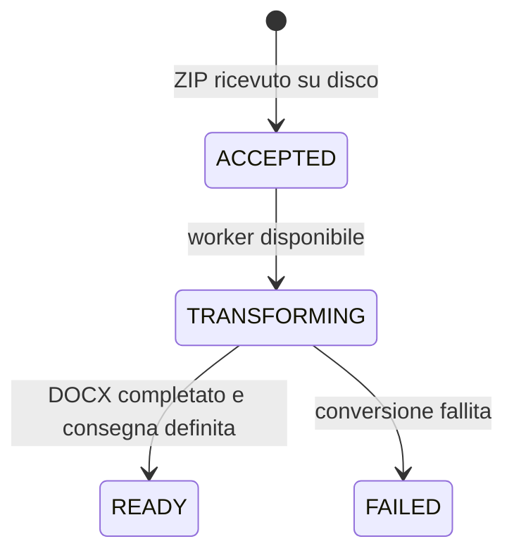

# Esportazioni asincrone (0.3)

Branch: `feature/async-large-exports`. Avvio e JDK restano quelli del README. Per pacchetti grandi usare il nuovo flusso: la richiesta termina dopo il trasferimento del file e la sua presa in carico, mentre parsing/rendering proseguono su un executor limitato.

## Stati e API



`POST /api/papyrus/jobs` accetta `multipart/form-data` con `file` e `delivery=DOWNLOAD` oppure `EXIST_URL`. Risposta **202 Accepted**, `Location: /api/papyrus/jobs/<UUID>` e JSON con stato `ACCEPTED`. L'upload stesso richiede ancora una connessione HTTP: il protocollo non implementa upload riprendibili.

Esempio dalla radice del repository (su Windows usare `curl.exe`):

```bash
curl --fail-with-body -D - \
  -F file=@src/test/resources/fixtures/pherc-1025.zip \
  -F delivery=DOWNLOAD \
  http://localhost:8081/api/papyrus/jobs
```

Usare l'UUID della risposta:

```bash
curl http://localhost:8081/api/papyrus/jobs/UUID
# Quando state è READY:
curl --fail-with-body -o pherc-1025.docx \
  http://localhost:8081/api/papyrus/jobs/UUID/document
```

`GET /api/papyrus/jobs/config` espone limiti di upload, modalità abilitate e retention. Il polling restituisce gli stati effettivi, non un timer che simula avanzamento. `acceptedAt`, `transformationStartedAt`, `completedAt` documentano i tre momenti anche se una conversione termina fra due richieste di polling. Non viene esposta una percentuale stimata.

In `READY`, il JSON contiene `filename`, MIME, numero di frammenti, modalità di consegna effettiva, `resultUrl`, eventuale `warning` ed `expiresAt`. In `FAILED` contiene `errorCode` e `error`. Un job fallito non offre documenti parziali. Download prima di READY: **409**; job inesistente: **404**; job scaduto ancora presente: **410**, oppure **404** se già ripulito.

## Due modalità di consegna

- **DOWNLOAD**: `resultUrl` punta all'endpoint locale `/document`. Il browser scarica direttamente lo stream, senza `response.blob()` per l'intero file.
- **EXIST_URL**: disponibile solo con `EXISTDB_ENABLED=true`. Viene creata una collection dedicata `job_<UUID>` e caricato il **DOCX binario**, MIME DOCX, tramite PUT. Un HEAD verifica tipo e dimensione prima della risorsa pronta. L'URL restituito identifica il DOCX conservato, non i soli XML originali.

Per eXist rimangono necessari collection base esistente e account con permessi limitati. Impostare `EXISTDB_PUBLIC_REST_URL` al prefisso REST raggiungibile dal browser (es. `https://edizioni.example/exist/rest`), senza `/db` finale. Se omesso viene usato `EXISTDB_REST_URL`: un hostname interno Docker potrebbe quindi non essere apribile dal browser. Non vengono mai inserite credenziali nell'URL. Permessi di lettura e autenticazione della risorsa restano quelli dell'istanza eXist; il servizio non rende pubblici i documenti automaticamente.

In caso di eXist indisponibile, errore di scrittura o verifica fallita, il job diventa **READY con DOWNLOAD** e un avviso esplicito. La copia locale corretta resta disponibile. La modalità URL richiesta con eXist disabilitato viene rifiutata con **400** prima della presa in carico.

L'archiviazione sincrona degli XML resta distinta: `archive=true` sull'endpoint storico riguarda i sorgenti; `delivery=EXIST_URL` sui job riguarda il documento finale. Non viene effettuata una seconda conversione sul database.

## Interfaccia

Il pulsante mostra un'icona rotante durante upload, attesa e trasformazione; restano utilizzabili selezione del file, scelta della consegna e invio di un altro pacchetto. Ogni esportazione ha una scheda e il proprio stato. Un doppio click sul medesimo upload in corso viene ignorato. Una volta pronto, il link permette di scaricare o aprire il documento; il download non parte automaticamente per evitare blocchi del browser.

Gli identificativi sono conservati in `sessionStorage`: ricaricando la stessa scheda si riprende il polling. Chiudere la pagina non cancella il lavoro sul server. Un'interruzione del polling viene ritentata; un upload senza risposta non viene ritentato automaticamente, perché potrebbe essere già accettato. La sessione browser non sostituisce l'archivio server e non conserva credenziali.

## Limiti e memoria

Default asincroni configurabili con proprietà Spring `export.jobs.*`:

| Proprietà | Default |
|---|---|
| `workers` / `queue-capacity` | 1 trasformazione attiva, 4 in attesa |
| `max-stored-jobs` | 16 job, inclusi quelli completati non scaduti |
| `max-upload-bytes` | 512 MiB ZIP |
| `max-entry-bytes` / `max-expanded-bytes` | 8 MiB per XML / 256 MiB decompressi |
| `max-entries` / `max-fragments` | 4096 entry / 512 frammenti |
| `max-text-lines` / `max-text-chars` | 50.000 righe / 16.777.216 unità UTF-16 |
| `max-output-bytes` | 128 MiB DOCX |
| `max-disk-bytes` | 2 GiB per directory dei job, con prenotazione dell'output massimo |
| `retention` | 2 ore dal completamento/fallimento |

Multipart globale: 512 MiB per file, 513 MiB per richiesta (`EXPORT_UPLOAD_LIMIT`, `EXPORT_REQUEST_LIMIT`). Adattare anche `export.jobs.max-upload-bytes` e i limiti del reverse proxy se si cambia soglia. Il percorso sincrono resta limitato a ZIP di 8 MiB.

Upload e DOCX sono file su disco. Nel percorso asincrono non sono mantenuti i byte di ogni XML originale, e il renderer scrive direttamente sul file di output. **POI e il modello editoriale lavorano ancora in memoria**: asincronia non significa memoria costante o dimensioni illimitate. I limiti testuali/decompressi proteggono la JVM; dimensionare heap, worker e soglie con un benchmark del proprio corpus. Compose riserva 1536 MiB; partire da un solo worker per documenti grandi. Non è dichiarata la capacità di trasformare qualsiasi ZIP da 512 MiB: tutti i limiti devono essere rispettati.

Quando coda o numero di job sono pieni: **429** con `Retry-After`. Spazio prenotabile esaurito: **503 JOB_STORAGE_FULL**. Upload oltre soglia: **413**. Anche il multipart temporaneo richiede spazio, oltre ai file riservati per i job; limitare gli upload simultanei al gateway e monitorare il volume. Se il filesystem è realmente pieno, un errore I/O può precedere la prenotazione applicativa.

## Persistenza, riavvio e scadenza

In avvio locale i job sono in `./data/export-jobs` (ignorato da Git). Impostare `EXPORT_JOBS_DIRECTORY` per un percorso diverso. La directory deve essere scrivibile; una lock impedisce a due istanze di usare contemporaneamente lo stesso archivio. Questa implementazione è per **una singola istanza**, non per un cluster distribuito.

Gli stati sono manifest JSON sostituiti atomicamente. Al riavvio i risultati pronti vengono recuperati; i lavori interrotti diventano `FAILED / SERVER_RESTARTED`, senza ripetere automaticamente conversione e archiviazione. Il client può reinviare il pacchetto. La coda è quindi persistita come stato, non è una coda distribuita con retry automatico.

Il pulitore rimuove risultati e metadati locali scaduti ogni minuto. Gli upload sorgente sono rimossi dopo il lavoro; i file parziali non vengono offerti al download. I DOCX salvati su eXist hanno una retention separata, gestita sul database: il cleanup locale non li elimina. In caso di errore eXist si tenta di eliminare solo la collection del job; se non confermato viene registrato il suo ID.

Nel container `/data/jobs` e `/data/uploads` sono su un volume, con utente 10001; `EXPORT_UPLOAD_DIRECTORY` sposta il temporaneo multipart sul disco anziché sul tmpfs. Compose conserva il volume attraverso stop/riavvio. Non condividere il volume fra più repliche.

Gli UUID sono identificativi non prevedibili, ma non sostituiscono l'autorizzazione: per esposizione pubblica applicare autenticazione e controllo accessi a creazione, stato e download nel proprio gateway. Il sistema non implementa utenti o isolamento multi-tenant.

## Verifiche

La suite copre il percorso completo con il campione reale, upload oltre 8 MiB, stati/coda deterministici, risultati dopo riavvio, recupero dei lavori interrotti, scadenza, quota e consegne estendibili. Il trasporto eXist binario è verificato con un server REST di prova (PUT MIME/byte, HEAD, URL pubblico e fallback), non con la specifica istanza dell'utente. Il test JavaScript della view esegue il modulo effettivo con un adattatore DOM di test per verificare spinner e controlli non bloccati; non è un confronto visuale in Chrome.

`scripts/smoke-container.sh` prova sia l'API compatibile sia la nuova API 202/poll/download con eXist irraggiungibile. I test funzionali non sono un benchmark del massimo carico di produzione.
